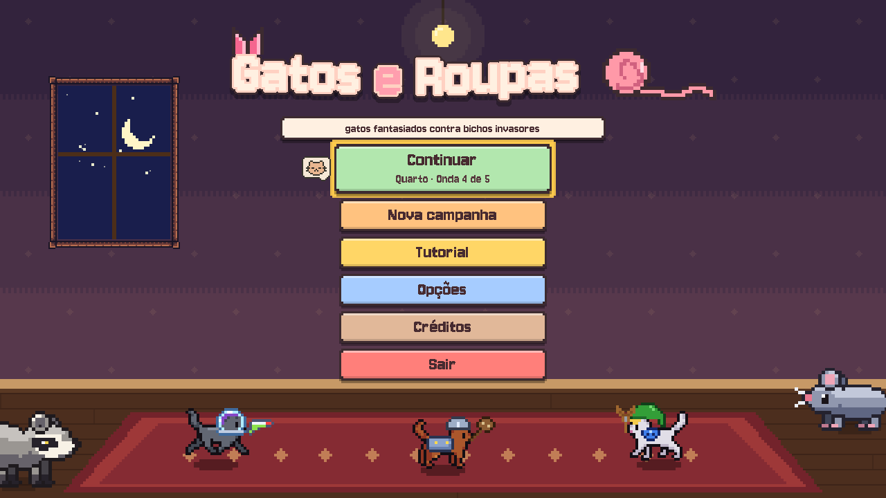
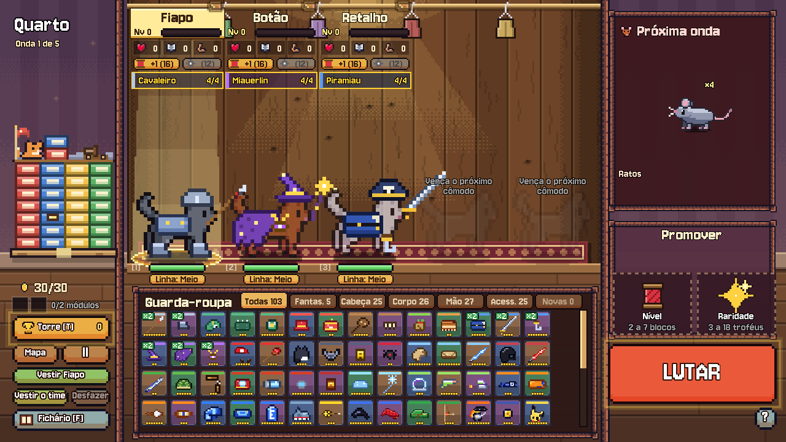
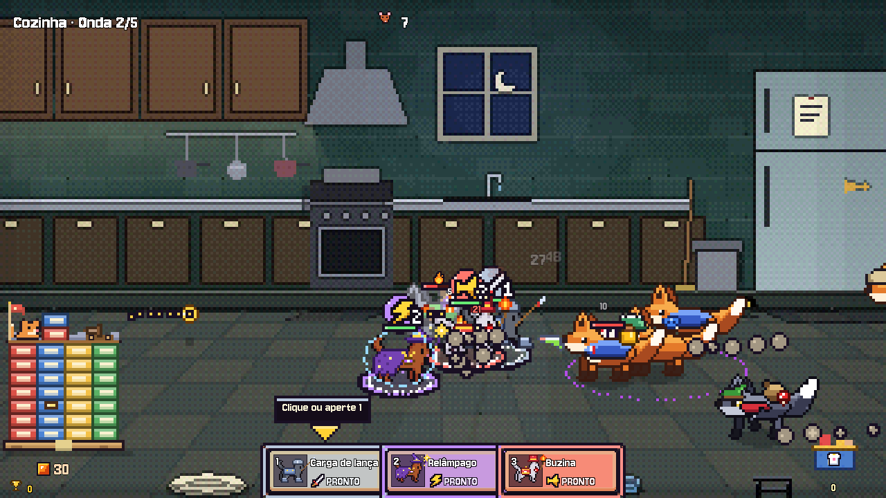
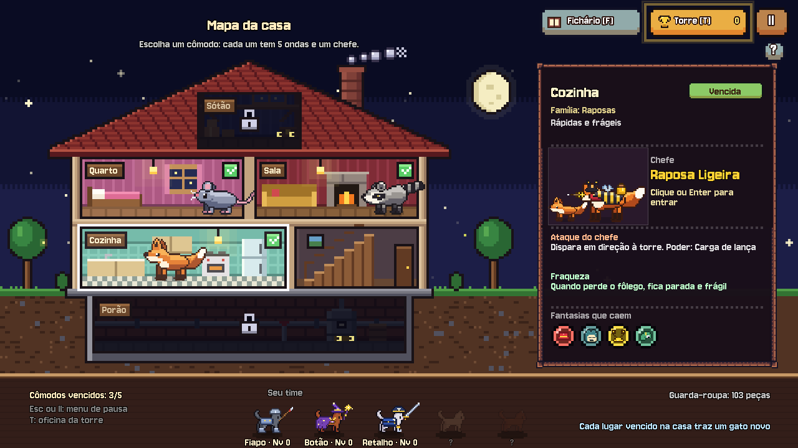

# Gatos e Roupas

Gatos fantasiados defendendo a casa contra bichos invasores.

Ratos, guaxinins, raposas, corvos e sapos querem tomar a casa, cômodo por cômodo. Do
outro lado está um time de gatos — e o que decide a luta é o que eles estão vestindo.
Cada peça de roupa muda o jeito de o gato lutar, e quem completa a fantasia ganha um
poder especial.

Feito em Godot 4, em pixel art.

## A ideia

A inspiração é *Strike Force Kitty: Last Stand*, um jogo em Flash que infelizmente não
está mais disponível por completo. *Gatos e Roupas* parte dessa ideia: um time de gatos,
um guarda-roupa cheio de peças e muita luta.

## A campanha

A campanha tem três atos. A casa tem cinco cômodos — Quarto, Sala, Cozinha, Sótão e
Porão —, cada um com a sua família de bichos, cinco ondas e um chefe no fim. Vencida a
casa, a aventura continua do lado de fora: quintal, garagem, telhado, rua e a toca, com
chefes novos. Por último vêm as ruas do bairro, onde o time enfrenta gangues de outros
gatos, também fantasiados, cada uma com os seus truques e um chefe.

Pelo caminho:

- **quase 60 fantasias** para colecionar peça por peça, guardadas num fichário
- **gatos que crescem** junto com a campanha e herdam os poderes das fantasias que vestiram
- **uma torre** que protege a casa e melhora com os troféus ganhos nas lutas
- **o Ateliê**, onde quem completa o fichário cria a própria fantasia
- **segredos**, invasão sem fim e metas para depois de terminar a campanha

## Créditos

Gatos: **Last tick**. Interface: **PaperHatLizard** e **ToffeeCraft**. Fonte: **Jersey 10**,
de Sarah Cadigan-Fried (The Soft Type Project). Os efeitos sonoros foram sintetizados para
o jogo.
